# BIsql 平台业务流程梳理

> 目的：把"看起来很多很乱"的功能，还原成**几条说得清的流程**。
> 依据：当前代码实际结构（64 个接口 / 27 张表 / 6 套定时任务）。
> 日期：2026-10-13
>
> **配图**（渲染好的 PNG，可直接看/贴汇报）在 [`docs-diagrams/`](../docs-diagrams/)：
>
> | 图 | 内容 |
> |---|---|
> | [01 顶层全景](../docs-diagrams/01-顶层全景.png) | 一条主动脉，五条出口 |
> | [02 数据进来](../docs-diagrams/02-数据进来.png) | 接入流程（ERP→ods→数据集） |
> | [03 权限生命周期](../docs-diagrams/03-权限生命周期.png) | 申请/审批/有效期/撤销 |
> | [04 数据出去](../docs-diagrams/04-数据出去.png) | 五个出口与唯一裁剪器 |
> | [07 问数闸门](../docs-diagrams/07-问数闸门.png) | 自然语言问数的七个步骤 |
> | [05 数据加工](../docs-diagrams/05-数据加工.png) | 编排 → dbt → 产物 |
> | [06 值守任务](../docs-diagrams/06-值守任务.png) | 后台定时任务 |

---

## 一、一句话看懂这个平台

> **把 ERP 的数据搬进来，管好谁能看哪部分，然后从五个出口安全地发出去。**

平台只有**一条主动脉**，其余全是挂在这条动脉上的能力：

```
   源数据  ──搬──▶  数据集  ──管──▶  权限  ──发──▶  五个出口
   (ERP)            (ods)          (行级+字段)      (Web/API/MCP/问数/编排)
```

觉得乱，是因为**能力是横向叠加的**，而这条动脉从来没被画出来过。
下面把它画出来。

---

## 二、顶层全景

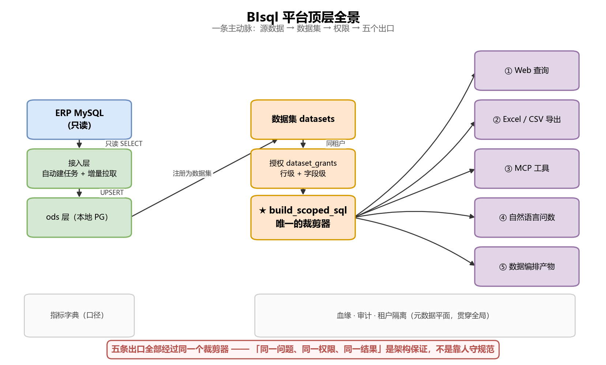

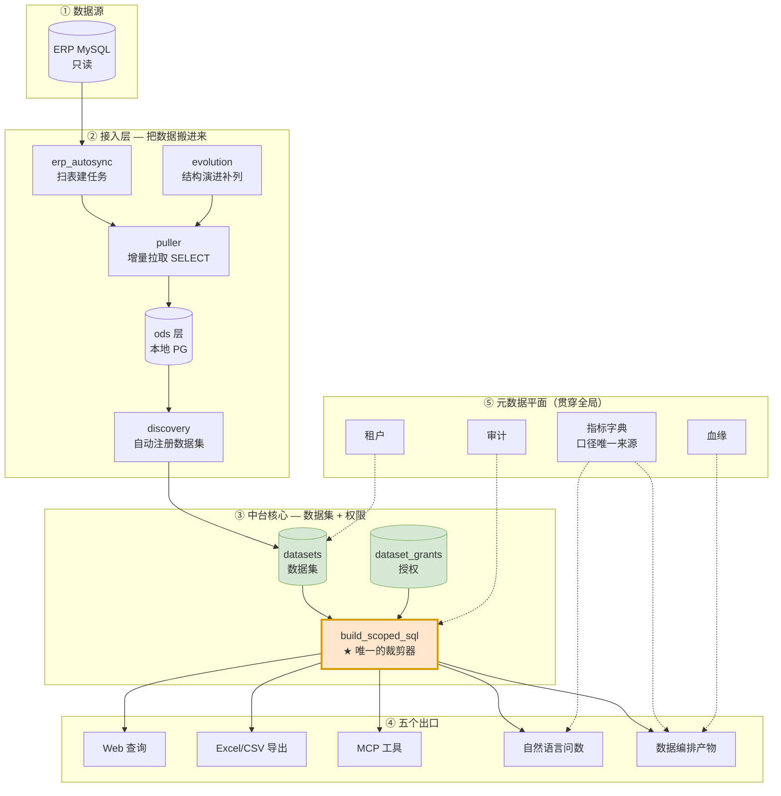

**关键点**：`build_scoped_sql` 是所有出口的必经之路。
这一个设计是整个平台最重要的结构——**要理解乱不乱，就看有没有绕过它**。答案是：没有。

---

## 三、四条主干流程

### 流程 1：数据进来（接入）

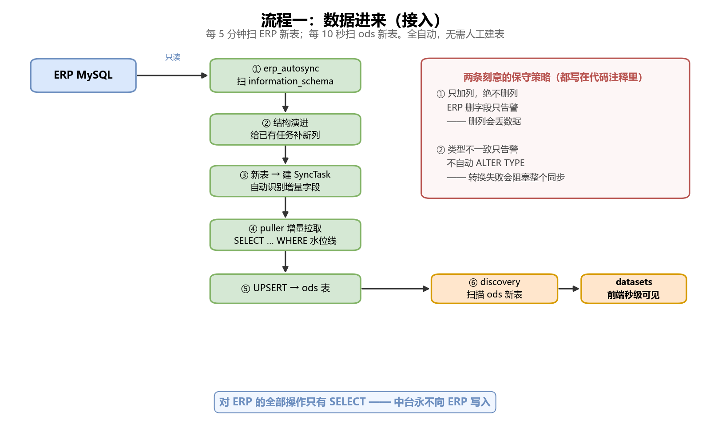

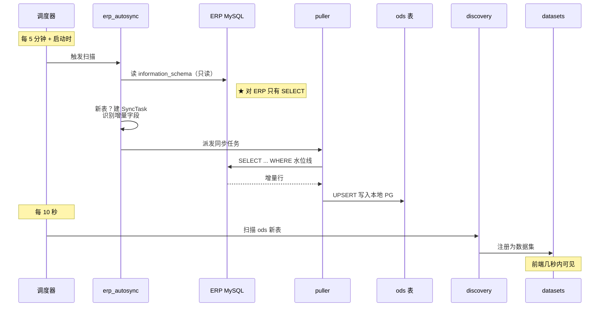

**这一步的两个设计取舍**（都写在代码注释里）：
- **只加列不删列**：ERP 删字段只告警，不自动删本地列（删了会丢数据）
- **类型不一致只告警**：不自动 `ALTER TYPE`（存量数据转换失败会阻塞整个同步）

### 流程 2：谁来管（权限全生命周期）

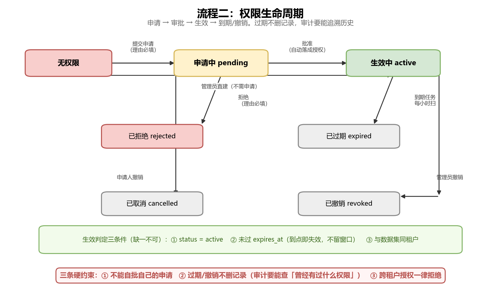

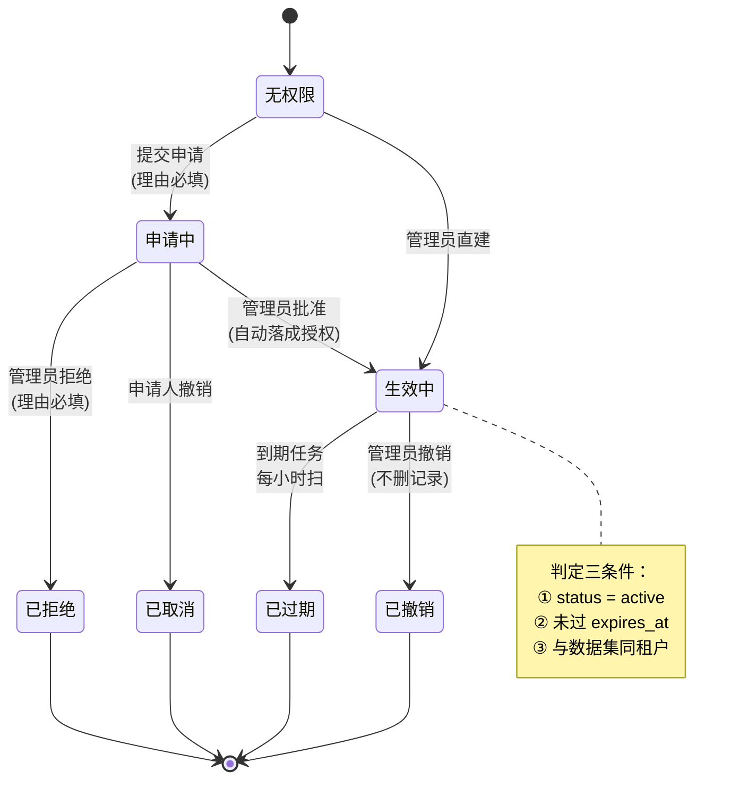

**三个刻意的约束**：
1. **不能自批**自己的申请 —— 否则申请流形同虚设
2. **过期不删记录** —— 审计要能回答"这个人曾经有过什么权限"
3. **跨租户授权一律拒绝** —— 即使数据库里有这条记录

### 流程 3：数据加工（编排）

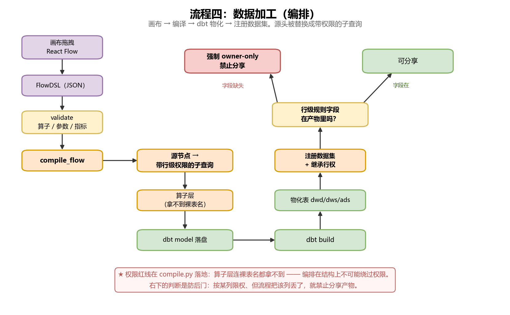

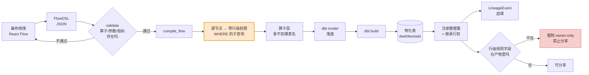

**这条流程最重要的性质**：编排在**结构上不可能绕过权限**。
因为源节点被替换成带 WHERE 的子查询，算子层连裸表名都拿不到。

`J` 那个分支是防后门的：如果按 `warehouse` 限权但流程把 `warehouse` 列丢了，
就不能分享产物——否则 owner 能把自己看不到全貌的数据分享出去。

### 流程 4：数据出去（五个出口）

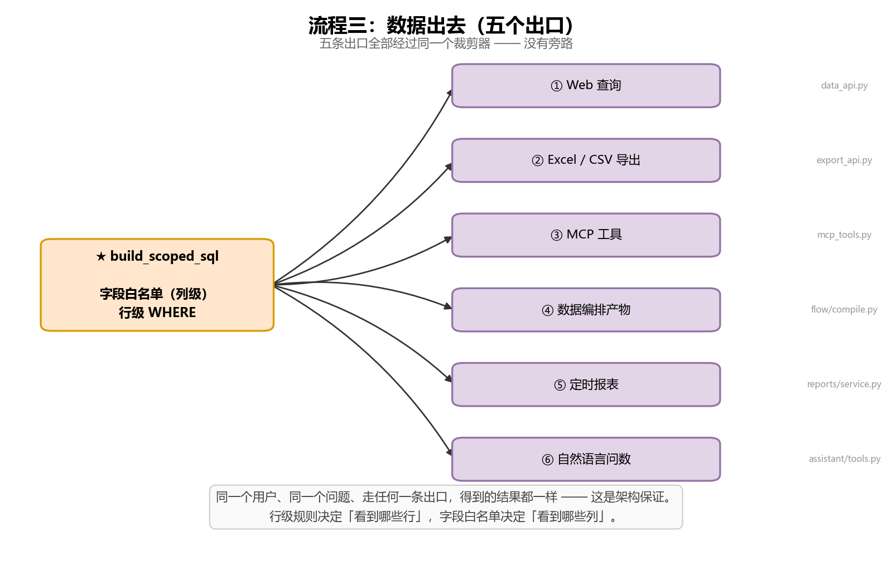

问数作为其中一条出口，单独展开（LLM 只参与前两步）：

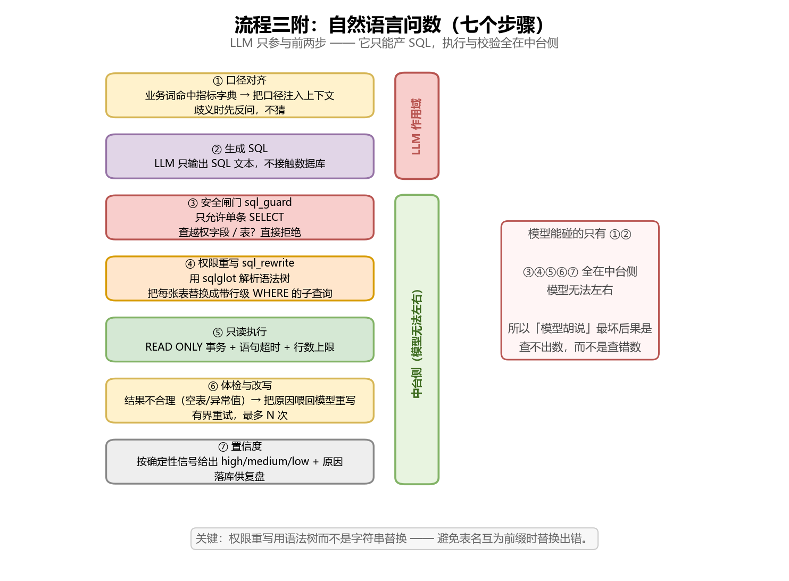

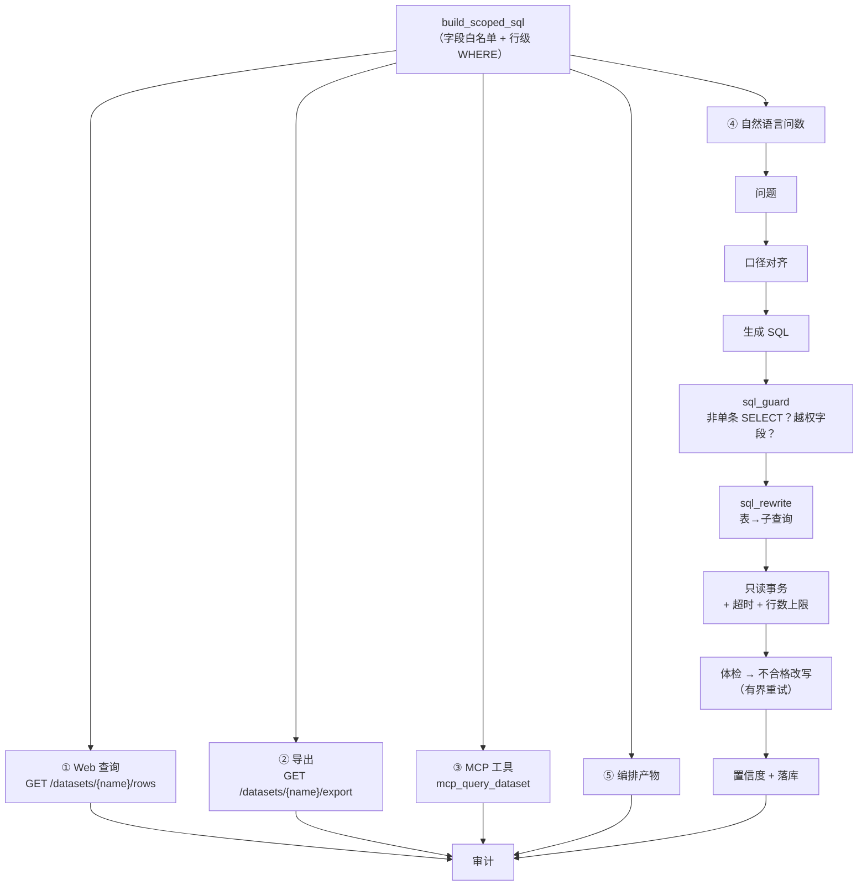

**五个出口共用同一个裁剪器**——这是"同一问题、同一权限、同一结果"的架构保证，
不是靠人守规范。

---

## 四、三条值守流程（定时在后台跑）

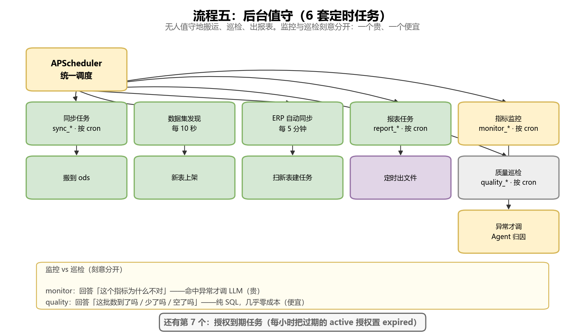

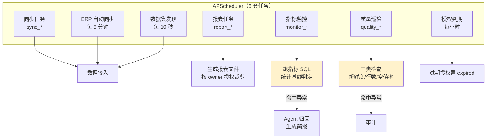

**监控与巡检的区别**（容易混，但设计上是刻意分开的）：

| | `monitor_*` | `quality_*` |
|---|---|---|
| 回答 | "这个指标为什么不对" | "这批数到了吗/少了吗/空了吗" |
| 成本 | 命中异常才调 LLM 归因 | 纯 SQL，几乎零成本 |
| 输出 | Agent 简报草稿 | 巡检结果 + 审计 |
| 频率 | 按业务节奏（每天/每周） | 每天都能跑 |

---

## 五、角色视角：谁用哪条流程

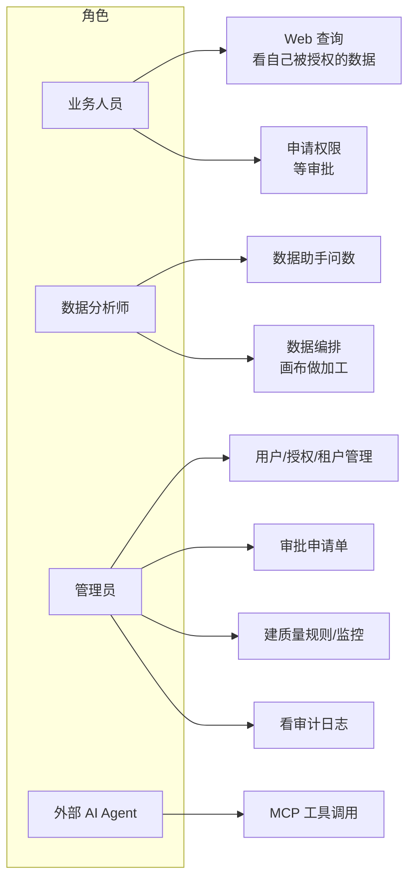

---

## 六、为什么会觉得乱 —— 诊断

我把 `乱` 拆成四个具体原因，都能对应到实际代码：

### 1. 能力是"叠加"的，不是"分层"的

27 张表里，有 **11 张是后加的能力表**（monitor / quality / lineage / grant_request / tenant / provider / eval…）。
它们都挂在同一个平面上，没有明确的"层"边界。

**但实际上是有层的**——只是没人画出来：

| 层 | 内容 | 表 |
|---|---|---|
| **数据层** | 搬运与加工 | `sync_tasks` `sync_history` `data_flows` `flow_runs` |
| **权限层** | 谁能看什么 | `users` `roles` `datasets` `dataset_grants` `grant_requests` `tenants` |
| **元数据层** | 口径与血缘 | `metrics.yml`(文件) `lineage_events` `verified_qa` |
| **运行层** | 调度与观测 | `monitor_*` `data_quality_*` `report_*` `agent_*` |
| **凭证层** | 审计与密钥 | `audit_logs` `api_keys` `ai_llm_cache` |

按这个分，27 张表立刻变成 5 组，每组 3-6 张。

### 2. 命名不统一，同类东西有两个名字

| 实际是两个东西 | 名字看起来像一类 |
|---|---|
| `sync`（搬数据） | `flow`（加工数据） |
| `monitor`（指标异常→归因） | `quality`（数据体检） |
| `report_tasks`（定时出文件） | `flow`（定时出表） |

**建议**：不改代码，但**在文档和界面上统一措辞**。
比如界面上把 `sync` 叫"数据接入"、`flow` 叫"数据加工"，
`monitor` 叫"指标监控"、`quality` 叫"质量巡检"。

### 3. 五条出口散落在五个文件里

```
app/api/data_api.py          → Web 查询
app/api/export_api.py        → 导出
app/mcp_tools.py             → MCP
app/assistant/chat_api.py    → 问数
app/flow/compile.py          → 编排
```

它们**逻辑上是同一个东西的五个面**，但物理上分散。
这是合理的（关注点分离），只是需要一张图说明"它们都走同一个裁剪器"。

### 4. 三套"权限"概念容易混

| 名字 | 管什么 | 在哪 |
|---|---|---|
| `is_admin` | 租户**内**的管理权 | `users.is_admin` |
| `is_superadmin` | **跨租户** | `users.is_superadmin` |
| `DatasetGrant` | 数据集**行级+字段级** | `dataset_grants` |

前两个是"能不能做管理动作"，第三个是"能看到哪些行/列"。**两者正交。**

---

## 七、建议的梳理动作

按投入产出排序：

1. **把这份文档放到 `docs/` 并加到 README 索引** —— 成本最低，收益最大
2. **界面上统一措辞**（同步→数据接入、编排→数据加工、监控→指标监控）
3. **前端加一个"平台地图"页** —— 把上面那张全景图做成可点的导航
4. **给 27 张表在模型文件里加分组注释** —— 按上面那 5 层
5. （可选）**把五条出口的公共部分显式抽成一个 `router.py`** —— 让"必经之路"在代码里也可见

---

## 八、一句话总结

平台不乱的**证据**是：只有一条主动脉，所有出口共用同一个裁剪器，编排绕不过权限。

觉得乱是因为**没人把这张图画出来**，而不是结构真的失控。
上面这些图就是那张图。
